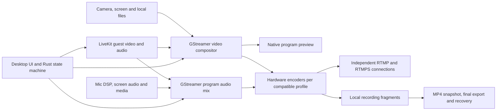

# Broadcast Studio desktop design brief

**Release target** · Full feature parity with the current web studio on Linux, Windows, and macOS. Use Rust and GStreamer for the host’s media engine, prefer working hardware acceleration, and ship the media runtime with the desktop app.

The desktop host should capture and composite the 1920 × 1080 program once, show that program locally, and feed it to recording and the enabled streaming profiles. Keep LiveKit for remote guests and browser invitations. A solo host should be able to preview, record, and stream to configured destinations without running a room server, Redis, Egress, or a public application tunnel.

Current behavior is based on repository revision `63954cc3583355d41c99f7b2d557b196b5f072c5`. The proposed design and release gates below are implementation targets.

## Current studio functionality

| Area | Behavior to carry forward |
| --- | --- |
| Setup and controls | Credential-free preview with sample participants. Host passcode and guest invitation flow. Display name, independent mic check, camera preview, device selection, camera/mic toggles, M/C shortcuts, media monitoring, and clear differentiation between entering the studio, recording, and going live. [Setup and studio](../apps/web/src/Prejoin.tsx) · [Host controls](../apps/web/src/Studio.tsx) |
| Room and backstage | One host and up to three browser guests. People list, camera/mic status, host-controlled staging and spotlight, and guests return backstage after disconnecting. Backstage participants can talk in the room. Only staged voices enter the broadcast, including staged people whose pictures are hidden by the layout. Chat stays in the studio, with unread indication and up to 100 recent messages per API lifetime. [Room service](../apps/api/src/service.ts) · [Program audio](../packages/studio/src/index.tsx) · [Messages](../apps/web/src/MessagesPanel.tsx) |
| Layouts and screen sharing | Solo, Split, Inset grid, Spotlight, Screen + presenter, Screen + cameras, Picture in picture, Screen + cutout, and Screen only. Cameras fill their tiles and shared screens fit their frames. Preserve name badges, camera-off graphics, selected presenter, stage background, and the current framing. The host’s share stages immediately. A guest’s share requires a host action. Removing a share from stage leaves capture running, and ending the selected share returns to the camera grid. Carry the selected share’s audio when available. [Layout definitions and commands](../packages/contracts/src/index.ts) · [Program renderer](../packages/studio/src/index.tsx) |
| Branding and media | Folder-based library with subfolders and refresh. Logos are PNG/JPEG/WebP, overlays PNG/WebP/GIF, virtual backgrounds PNG/JPEG/WebP, clips MP4/WebM, and music and effects MP3/WAV/OGG. Preserve logo placement, overlay fade, program backgrounds, codec error reporting, preloaded/replayable sounds, loop and volume controls, and music pause/resume. A takeover clip hides live visuals, replaces live program voices, pauses music at its current position, and clears the effect. Room conversation continues. Music resumes only if it was playing before the clip. [Media behavior](../README.md#media) · [Playback and transitions](../packages/contracts/src/index.ts) |
| Camera effects | Off, adjustable blur, image replacement with shared or local images, stable foreground, experimental person-only foreground, and the transparent presenter layout. Cutout occupies the bottom-right 324 × 276 inset at `(1548, 756)` on the program canvas. If cutout processing fails, use a placeholder so the camera background stays private. Preserve preview and outgoing framing through changes and camera restarts. [Camera processor](../apps/web/src/background-processor.ts) · [Cutout renderer](../packages/studio/src/ForegroundVideo.tsx) · [Effect verification](VERIFICATION.md#bottom-right-transparent-presenter--2026-10-17) |
| Voice and monitoring | Optional RNNoise and voice DSP with Natural speech and Warm broadcast voice presets, live controls and meters, echo-cancellation choice, and an eight-second parallel raw/processed mic audition. Preserve rolling loudness gain with ±3 dB default and 0–6 dB range, hold during pauses, and smooth gain changes. Keep processing per microphone. Headphone/media monitoring changes only the listener’s feed. The host’s own microphone is excluded from automatic monitoring. [Voice DSP](../apps/web/src/voice-dsp.ts) · [Voice settings](../apps/web/src/VoiceSettings.tsx) · [Media monitoring](../README.md#media) |
| Destinations | Manual YouTube, Twitch, and X RTMP/RTMPS setup with per-destination profiles, protected keys, explicit start/stop, duplicate-start protection, and per-output errors. Same-profile outputs share an encode. “Sending” describes encoder delivery. The platform controls audience publication, including any scheduled broadcast’s Go Live step. [Destination UI](../apps/web/src/Destinations.tsx) · [Output control and grouping](../apps/api/src/service.ts) |
| Recording | Independent full-program recording, optional subfolder and name, completed-segment progress, Save so far during capture, final MP4 on stop, Save as, history, interrupted-session recovery, export retry, and confirmed deletion of selected recording folders. Original segments survive failed exports. Default-on MP4 normalization targets −15 LUFS for the whole mix, including guests, clips, screen audio, and music. It copies video, preserves stereo balance with linear gain when peak headroom permits, and handles silence/video-only. Live streaming and raw segments keep the original audio. [Recording service](../apps/api/src/recordings.ts) · [Recording workflow](../README.md#continuous-recording-and-recovery) |
| Diagnostics | Report actual camera capture resolution and frame rate separately from the best outgoing WebRTC layer and the program format. Preserve sender constraint diagnostics, startup failures, independent recording/broadcast status, and recoverable errors. [Camera quality diagnostics](../apps/web/src/stream-quality.ts) · [Verification history](VERIFICATION.md) |

### Output profiles in the current code

| Output | Video | Video bitrate | Keyframe interval |
| --- | --- | ---: | ---: |
| YouTube | H.264 Main, 1920 × 1080 at 60 fps | 17,000 kbps | 2 s |
| Twitch | H.264 Main, 1920 × 1080 at 60 fps | 6,000 kbps | 2 s |
| X | H.264 Main, 1280 × 720 at 60 fps | 9,000 kbps | 3 s |
| Recording | H.264 Main, 1920 × 1080 at 60 fps | 6,000 kbps | 2 s |

Current profiles use AAC at 128 kbps and 48 kHz. X also offers 1080p30 and 720p30, with a 12,000 kbps cap. The defaults total 32 Mbps video upload for three destinations, plus audio, protocol overhead, and any outgoing WebRTC tracks. Keep the existing profiles as parity fixtures, and confirm actual ingest and playback when testing against the platforms. [Profile defaults](../packages/contracts/src/index.ts) · [Encoding options](../apps/api/src/livekit.ts) · [Recording request](../apps/api/src/recordings.ts)

## Current setup and cost of the media path

- **Application.** Bun and Turborepo run the React/Vite host and guest interfaces, Express API, shared contracts, and shared React program renderer. Development uses Vite on 5173 and proxies to the API, which defaults to 3001. Production Express serves the built web app. Runtime studio state is kept in LiveKit room metadata, chat and destination overrides are in API memory, and browser preferences are local. The single API process serializes state changes and recovers active jobs from LiveKit. [Application setup](../README.md#run-locally) · [API](../apps/api/src/app.ts) · [Preferences](../apps/web/src/store.ts)
- **Configured workstation mode.** The root environment points to localhost LiveKit and a nonlocal HTTPS application URL. Recording enablement and media/recording roots use the defaults. A listener check found none of the default local studio, LiveKit, or Redis ports active at the time of analysis. Internet guest reachability remains unverified. [Configuration defaults](../apps/api/src/config.ts)
- **Local services.** The project ships Linux host-networked Compose with LiveKit Server 1.13.10, Egress 1.15.0, and Redis 7.4.6. The preparation script generates local service configuration and preserves credentials. Signaling is on localhost:7880, Redis on localhost:6389, and the configured WebRTC ports are TCP 7881 and UDP 7882. Egress uses CPU encoding, with a 16-CPU limit, 20 GiB memory limit, and 1 GiB shared memory. The localhost profile is for same-workstation tests. A public room requires reachable WebRTC media and TURN as needed. [Compose](../compose.livekit.yaml) · [Preparation script](../scripts/prepare-local-livekit.py) · [Local setup](LOCAL_LIVEKIT.md) · [LiveKit ports and firewall](https://docs.livekit.io/transport/self-hosting/ports-firewall/)
- **Live path.** The browser captures and publishes tracks to LiveKit. Every distinct enabled profile starts a template Egress job that opens the application’s scoped renderer in Chromium, subscribes to tracks, renders the program, and encodes its output. The API checks the HTTPS renderer and asset manifest before launch. Three default destinations create three Egress jobs. The fourth job for recording renders independently, and writes roughly two-second HLS segments to the API/Egress shared folder. FFmpeg exports a finite playlist to MP4. [Renderer](../apps/web/src/Broadcast.tsx) · [Egress gateway](../apps/api/src/livekit.ts) · [Recording implementation](../apps/api/src/recordings.ts)

## Desktop architecture

### Rust owns the program and output state

- **One authoritative scene model.** Port the versioned studio state and commands to Rust. Use the TypeScript behavior, layout rectangles, and existing test cases as fixtures. Feed the same scene and audio policy to preview, live outputs, and recording. Keep layout changes, track selection, clip transitions, and output operations serialized through the engine. Preserve scene and user preferences in local app data. Keep active capture and broadcasting opt-in after a restart.
- **One media clock.** Use GStreamer running time for local capture, playback, presentation, and A/V timestamps. Rebase remote tracks onto that clock with bounded buffering and drift handling. Keep program audio, room publishing, and private monitoring as separate routes. Carry camera/mic/screen tracks with their original source identity for guest rooms. Route selected screen audio once and make clip/voice transitions independent of the room conversation.
- **UI and native preview.** Reuse applicable React controls and TypeScript contracts in a thin Tauri shell if a native preview surface passes the platform spike. Keep raw frame data within the native engine and renderer. If embedding that surface costs a frame copy or introduces platform instability, use a native preview widget or window. Frame timing, capture permissions, device changes, and output lifecycle belong to the Rust engine.
- **Capture and graphics.** Prefer textures or hardware surfaces for capture, decode, composite, scale, preview, and encode where compatible. Candidate features include crop/fit, alpha composition, text and watermark textures uploaded on change, and accelerated mask inference on compatible devices. Run CPU voice DSP in bounded audio blocks. Keep a software video/effects path with a visible capacity check.
- **Independent output lifecycles.** Use a bounded queue and a supervised mux/connection branch for every destination. A stalled branch must time out and reconnect from fresh headers and an IDR without blocking other branches. Leaky queues suit the preview. Across encoded output, discard to a decodable restart point when resyncing. Attach compatible recording and streaming outputs at keyframes. Drain and finalize the recording independently of RTMP shutdown.

### Encode sharing and GPU budget

Use a profile key that includes dimensions, frame rate, codec and profile, rate control and bitrate, GOP, color format, and any latency or buffer settings needed by the consumers. Each destination gets its own `flvmux` and `rtmp2sink` or validated RTMPS equivalent. Reuse encoded access units before muxing when requirements match, and share AAC for branches with the same mix and audio parameters. The default Twitch and recording profiles are candidates for sharing. Require compatible closed GOPs, keyframe cadence, segment timing, codec headers, and quality settings before enabling sharing. Plan for four active video encoders when recording needs its own profile, plus any separate WebRTC sender encode. [GStreamer RTMP sink](https://gstreamer.freedesktop.org/documentation/rtmp2/rtmp2sink.html) · [GStreamer NVIDIA H.264 encoder](https://gstreamer.freedesktop.org/documentation/nvcodec/nvh264enc.html)

Every full-frame 1080p60 RGBA copy moves about 475 MiB/s. Log negotiated memory types and identify uploads, readbacks, and cross-adapter transfers. Prefer a single shared GPU context where the selected capture, compositor, preview, and encoder support it. For a system-memory source, upload once where possible. Keep segmentation masks at model resolution, reuse them between inference frames if needed, and composite on the GPU. Make decode, compositing, segmentation, and encoding independently visible in diagnostics. Hardware encode can pass while another stage still uses CPU or incurs a copy.

### Remote guests and web compatibility

Retain the browser guest flow and LiveKit room APIs. Provide a reachable control service for invites, scoped tokens and roles, state updates, chat, and compatible guest media access. Adapt the existing Express service for the first desktop release so current browser clients can be reused. Keep LiveKit signing credentials on that service and issue short-lived join tokens to the host and guests. Offer a managed LiveKit configuration and a supported self-hosted deployment recipe. The desktop app’s setup can validate and connect to either, and the loopback fixture can validate local media and room behavior.

Subscribe to guest camera, screen, and audio tracks in the host using the LiveKit Rust SDK. Publish the host’s camera, microphone, and screen tracks for guests. Spike the SDK-to-GStreamer boundary early for copies, timestamp drift, reconnect, and track replacement. For guest media monitoring, the first compatibility path can retain authenticated media playback in guest browsers with the existing play IDs and room clock. The host can ingest the same readable library. If moving media delivery to RTC later, route effects as a dedicated mix and switch guest monitoring to that route without duplicating playback or sending guests their own microphones. When a room drops, keep local sources, recording, and working live outputs running with disconnected guest placeholders. [LiveKit Rust capture API](https://docs.livekit.io/robotics/media/video/video-tracks/) · [LiveKit self-hosted deployment](https://docs.livekit.io/transport/self-hosting/deployment/)

### Recording and export

Use `splitmuxsink` or equivalent with approximately two-second fragments and an explicitly tested container. Start with self-contained MP4 fragments and a closed GOP. Confirm fragment finalization, remuxing without video re-encode, and compatibility after a recorder restart. Add a finalized fragment to an atomically updated index after it closes. Recover orphaned finalized fragments by validating on-disk files. A power loss can still cost buffered data or the open fragment. Use a frozen index snapshot for Save so far. Stop waits for the final segment, then exports using disk streams and atomic replacement of a temporary MP4. On disk exhaustion, stop recording with a clear status and preserve earlier fragments while live streaming continues. [GStreamer splitmuxsink](https://gstreamer.freedesktop.org/documentation/multifile/splitmuxsink.html)

Keep the current FFmpeg export semantics in the first release. Measure the entire mix, apply −15 LUFS with the current −2 dBTP peak target when normalizing, preserve channel balance when linear gain is sufficient, and copy video. Package a vetted FFmpeg build or validate an equivalent exporter against the current clips and loudness fixtures. Keep segments private, keep raw audio available, and guard cleanup against active capture/export and paths outside the recording library. Import existing media folders without copying by default. Treat legacy HLS recording import as a read-only scan with export to a new file. [Current MP4 export and normalization](../apps/api/src/recordings.ts)

## Platform acceleration and installation

| Platform | Capture and preview candidates | Hardware H.264 candidates | Release package |
| --- | --- | --- | --- |
| Linux | V4L2 cameras, PipeWire audio, Wayland ScreenCast portal and PipeWire video, plus X11 capture where supported. Test DMA-BUF import with the actual GPU and compositor. Prototype GL and CUDA/VA-compatible paths and keep adapter copies visible. | NVIDIA NVENC through `nvcodec`, Intel and AMD VA-API through `vah264enc` where the driver exposes encode. Probe compatible hardware decode separately. | Start validation on Mint/Ubuntu x86-64 with a pinned private media runtime and a package for the supported distro versions. Include the host libraries required by that package in its dependency metadata. [ScreenCast portal](https://flatpak.github.io/xdg-desktop-portal/docs/doc-org.freedesktop.portal.ScreenCast.html) · [VA H.264 encoder](https://gstreamer.freedesktop.org/documentation/va/vah264enc.html) · [CUDA compositor](https://gstreamer.freedesktop.org/documentation/nvcodec/cudacompositor.html) |
| Windows | Media Foundation cameras, WASAPI mic and loopback, Windows Graphics Capture or DXGI capture, and D3D-backed video surfaces. Validate textures on the same adapter, including hybrid laptops. | NVENC on NVIDIA, QSV on Intel, AMF on AMD, or hardware Media Foundation if tested. Verify the selected encoder and the actual D3D or CUDA memory types. | Signed x64 installer with app-private media libraries. Provision approved redistributables and WebView2 if the UI uses it, with a standalone installer option for offline setups. [D3D11 screen capture](https://gstreamer.freedesktop.org/documentation/d3d11/d3d11screencapturesrc.html) · [QSV](https://gstreamer.freedesktop.org/documentation/qsv/qsvh264enc.html) · [AMF](https://gstreamer.freedesktop.org/documentation/amfcodec/amfh264enc.html) · [WebView2 distribution](https://learn.microsoft.com/microsoft-edge/webview2/concepts/distribution) |
| macOS | AVFoundation cameras, Core Audio inputs, ScreenCaptureKit for screen and supported system audio, and a native preview. Test IOSurface/CVPixelBuffer interop and explicitly measure copies into compositing and encode. | VideoToolbox through `vtenc_h264_hw`. Probe real encoder sessions and source formats on supported Macs. | Developer ID-signed and notarized app/DMG with bundled frameworks and plugins. Validate Apple silicon first and ship an Intel build only after its parity and hardware tests pass. [AVFoundation video source](https://gstreamer.freedesktop.org/documentation/applemedia/avfvideosrc.html) · [ScreenCaptureKit](https://developer.apple.com/documentation/screencapturekit) · [VideoToolbox H.264](https://gstreamer.freedesktop.org/documentation/applemedia/vtenc_h264_hw.html) · [Apple notarization](https://developer.apple.com/documentation/security/notarizing-macos-software-before-distribution) |

**Installer.** Package pinned GStreamer libraries, plugin scanner, capture/decode/mix/encode/mux/sink plugins, software codecs, fonts, effects models, RNNoise assets, and the export helper. Use a versioned app-owned plugin path and registry. Ship core components with the installer so local preview and recording can start offline. Use signed and checksummed packages for optional components and repairs. Keep user data outside the runtime and verify upgrades and rollback on clean machines. Review redistribution terms for the current app and artwork, GStreamer plugins, FFmpeg build, H.264/AAC distribution, and ML models before shipping. [GStreamer deployment](https://gstreamer.freedesktop.org/documentation/deploying/index.html) · [Repository license](../LICENSE) · [Media license](../MEDIA_LICENSE.md)

**First run.** Enumerate OS/device/driver capabilities, then run a short encode and decode of generated frames through the actual backend. Probe each supported output combination, including concurrent hardware sessions. Show the active capture, render, and encode backends, plus missing components and dropped-frame counters. Automatically repair missing app-owned assets. For missing or incompatible system GPU drivers, identify the adapter and guide the user through the signed vendor or OS update flow with any required permissions or reboot. Request OS camera, microphone, and screen permissions at the relevant action. Run a tested software path if hardware is unavailable, and show which requested profiles the machine can sustain before the user starts a broadcast.

**External setup.** A first-run wizard can save destination keys in the OS credential store, validate the configured guest service, and guide provider setup. Let the user grant OS permissions and supply their own platform accounts, keys, or hosted room credentials. Keep keys out of command lines, logs, exported diagnostics, and guest state. Solo mode must launch and record on a clean offline install. Guest setup is complete when another device can join and exchange media through the configured service.

## Implementation sequence

| Milestone | Deliverable and exit check |
| --- | --- |
| 1. Platform feasibility | Build a headless Rust/GStreamer harness and a native preview spike for every OS. Prove camera, mic, screen and system audio, hardware H.264 caps and real buffers, preview under output load, one RTMPS connection, segmented recording, and media-runtime installation on clean machines. Record the exact adapter, driver, runtime build, plugin factories and negotiated memory type. |
| 2. Native program | Implement deterministic scene and playback state, compositing, source management, monitoring, voice DSP, effects and all nine layouts. Compare reference frames and PCM fixtures against the web app. Cover source loss, hidden staged voices, local clip takeover, timed music resume, and camera effects during device replacement. |
| 3. Live outputs and recording | Implement the three profiles, independent transport supervision, stream/record start and stop, per-output visibility, continuous saves, snapshots, export normalization, durable recovery, and scoped cleanup. Verify the MP4 artifacts and independently confirm platform playback. |
| 4. Guest parity | Wire current browser invitations and roles into the native host, guest camera and screen staging, room/backstage audio, guest monitoring, chat, control state, and reconnect behavior. Use real guests on another network and a TURN-required path. |
| 5. Release acceptance | Ship signed or integrity-verified installers, guided setup and diagnostics, and verify the full parity matrix on every supported OS. The preceding milestones are internal checkpoints for the same full-parity release. |

### Release acceptance and performance

- **Comparison run.** Use identical media fixtures, layout, effects, and output profiles on the current web stack and the desktop build. Where possible, put the web Egress stack and desktop app on the same test workstation and compare complete host-machine resource use. Measure CPU, GPU video encode/decode and 3D utilization, VRAM, working set, frame times, incoming and encoded FPS, skipped/dropped frames, clock drift, disk throughput, and network throughput. Capture results for single output, all three outputs with a recording, and the busiest guest/effects scene.
- **Initial performance targets.** On a qualified GPU configuration, run 60 minutes with the default three destinations, 1080p60 recording, a screen and staged cameras, and periodic clip/effects transitions. Keep program and destination dropped/late frames under 0.1% after startup and injected failures, keep steady-state A/V skew within 80 ms, and show bounded queues and memory. Target at least 30% lower total CPU utilization than the local software-Egress baseline in that matched workload. Set supported software fallback profiles from measurements. Record which parts of the workload use hardware.
- **Isolation and recovery.** Use local RTMP fixtures to inject slow ingest, broken sockets, and reconnects. Disconnect/replug capture, revoke screen share, drop the room connection, force a recorder crash, and simulate a full disk and interrupted export. Confirm unaffected outputs keep running, recording recovers completed fragments, and user-owned files survive cleanup. Measure recovery loss in seconds of program.
- **Production-style checks.** Exercise clean install, upgrade, permissions, and GPU fallback on the declared OS/hardware matrix. Test all nine layouts, all media formats, camera masks with motion and a real microphone boom, mixed audio and monitoring, recording access and normalization, and four-person guest rooms. Verify actual playback and A/V sync from each test destination as a viewer.

## Feasibility readback

- The existing repository suite passed **69 tests** with localhost binding available.
- On Linux Mint 22.3 with GStreamer 1.24.2, a synthetic software pipeline produced three independently parseable 1920 × 1080 at 60 fps H.264/AAC 48 kHz MP4 fragments, approximately 2.01 s, 2.01 s, and 1.03 s. This exercises segment finalization and format inspection. Crash recovery, remuxing, and live fan-out are separate acceptance tests.
- On the workstation’s GeForce RTX 5070 Ti with driver 595.99.02, the installed `nvcudah264enc` with `preset=p4` accepted NV12 in `CUDAMemory` after one explicit upload from a generated source. The resulting H.264 MP4 had 180 frames at 1920 × 1080 and 60 fps. The older `nvh264enc` factory on this runtime rejected its default preset, and `cudacompositor` was unavailable. The probe validates one NVIDIA encode, and the Intel integrated GPU, GPU compositing, capture, multi-encoder load, Windows, and macOS require separate validation.

## Brief for the first build session

> Use this design brief as the product specification. Build milestone 1 in a separate desktop workspace. Start with a Rust/GStreamer probe command that reports device and runtime capability, renders timestamped synthetic video and audio, previews the same program, records short fragments, and validates the output. Exercise a real hardware encode where supported and a software fallback. Record caps, memory transitions, detected encoders, frame timing, and artifact checks. Use local test destinations before testing one prepared RTMPS platform. Keep the Linux, Windows, and macOS parity and installer acceptance matrix as the release scope.
